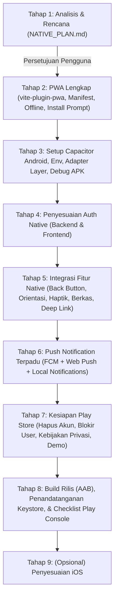

# RENCANA ARSITEKTUR & IMPLEMENTASI: PWA & NATIVE CAPACITOR ANDROID
**Portal Kampus Universitas Nasional Pasim Bandung**
*Versi Dokumen: 1.0 — Tanggal: 18 November 2026*

---

## 1. Ringkasan Eksekutif & Prinsip Desain

Dokumen ini memuat analisis mendalam, arsitektur, dan peta jalan teknis untuk mentransformasikan aplikasi web **Portal Kampus UNAS PASIM** menjadi:
1. **Progressive Web App (PWA)** yang dapat diinstal langsung dari browser dengan caching aman dan dukungan offline.
2. **Aplikasi Native Android (Capacitor)** berkualitas rilis Google Play Store yang dibangun dari **basis kode React yang SAMA**.

### Prinsip Utama (Non-Negotiable)
- **Satu Basis Kode**: Logika web yang sudah berjalan tidak boleh berubah atau terganggu. Seluruh fitur native diisolasi di balik lapisan adapter (`client/src/platform/`).
- **Keamanan Tanpa Kompromi**:
  - Web tetap memakai cookie `httpOnly` untuk refresh token.
  - Native memakai Android Keystore (Secure Storage) untuk refresh token, dan access token hanya di memori.
  - Cleartext HTTP dinonaktifkan pada build rilis Android.
  - Tidak ada secret, API private key, atau keystore yang di-commit ke Git.
- **Izin Android Minimalis**: Hanya menggunakan izin yang memiliki justifikasi fungsional nyata sesuai kebijakan privasi Play Store.
- **Kejujuran Teknis**: Bagian yang memerlukan pengujian perangkat fisik nyata (seperti hardware haptics tertentu, background notification saat app dimatikan, dan penandatanganan Play Store) dijelaskan secara transparan.

---

## 2. Audit Kondisi Kode Saat Ini

### A. Autentikasi (Auth)
- **Backend (`server/src/services/auth.service.js`, `server/src/controllers/auth.controller.js`)**:
  - Menggunakan JSON Web Token (JWT). Access token (masa aktif singkat ~15 menit) dan Refresh token (~7 hari).
  - Server saat ini mengirim refresh token via cookie `pasim_refresh_token` (`httpOnly: true`, `sameSite: lax/none`, `secure: prod`).
  - Mekanisme rotasi token dan deteksi reuse token (`revoked_at !== null` -> cabut seluruh sesi) sudah terimplementasi dengan baik di tabel `refresh_tokens`.
- **Frontend (`client/src/store/useAuthStore.js`, `client/src/api/axiosInstance.js`, `client/src/api/authBridge.js`)**:
  - `accessToken` disimpan murni di memori (Zustand state).
  - Pemulihan sesi (`initAuth`) memanggil endpoint `POST /auth/refresh` yang mengandalkan cookie browser.
  - `axiosInstance` memiliki interceptor dengan antrean refresh (`failedQueue`) untuk mencegah balapan request paralel.
- **Masalah pada Native (Capacitor)**:
  - WebView Capacitor di Android berjalan di origin `https://localhost` (via `androidScheme: 'https'`).
  - Cookie lintas domain (cross-origin cookie) antara `https://localhost` dan domain API produksi sering kali diblokir oleh kebijakan SameSite WebView, pembaruan Chromium OS, atau terhapus saat lifecycle backgrounding.
  - **Solusi**: Lapisan auth ganda (Dual-Auth Mechanism) yang diuraikan di Bagian 4.

### B. CORS (Cross-Origin Resource Sharing)
- **Backend (`server/src/utils/corsConfig.js`, `server/src/app.js`)**:
  - Whitelist saat ini hanya mencocokkan `CLIENT_URL` dan `http://localhost:5173` / `http://127.0.0.1:5173`.
  - Origin `https://localhost` (Android Capacitor) dan `capacitor://localhost` (iOS Capacitor) saat ini **akan ditolak** oleh CORS.
  - **Solusi**: Tambahkan origin native ke whitelist eksplisit di `corsConfig.js`.

### C. Service Worker & Web Push
- **Frontend saat ini**:
  - Terdapat file statis `client/public/sw.js` yang hanya berisi listener event `push` dan `notificationclick` sederhana.
  - Belum ada integrasi dengan `vite-plugin-pwa` atau Workbox untuk precaching app shell dan halaman offline.
  - Manifest web (`client/public/manifest.webmanifest`) saat ini sudah memuat konfigurasi awal, namun belum memiliki offline fallback dan Workbox precache hashing.
- **Backend saat ini**:
  - Menggunakan library `web-push` (VAPID) untuk browser.
  - Belum memiliki saluran FCM (Firebase Cloud Messaging) untuk aplikasi native Android.

### D. Pengunggahan & Pengunduhan Berkas
- **Frontend (`client/src/api/apiHelpers.js`, `MaterialDetailPage.jsx`, `CourseMaterialsPage.jsx`)**:
  - Pengunduhan berkas tunggal dan arsip ZIP saat ini memakai fungsi `triggerBlobDownload` yang membuat elemen `<a download="filename">` dan memicu `link.click()`.
  - Di Android WebView, memicu unduhan via blob URL `<a download>` sering kali gagal secara senyap (silent fail) karena WebView tidak memiliki download listener bawaan tanpa plugin Filesystem native.
  - Pengunggahan foto/materi memakai elemen `<input type="file">`. Ini berjalan baik di web, namun di Android native memerlukan konfigurasi WebChromeClient file picker atau `@capacitor/camera` / system photo picker.

---

## 3. Daftar Plugin Capacitor & Izin Android

Semua plugin dipilih berdasarkan kebutuhan esensial. Tidak ada plugin berlebih yang memperbesar ukuran APK.

| No | Plugin | Fungsi & Alasan | Izin Android yang Ditambahkan |
|---|---|---|---|
| 1 | `@capacitor/core` & `@capacitor/android` | Runtime inti Capacitor dan bridge WebView | `android.permission.INTERNET` |
| 2 | `@capacitor/app` | Menangani tombol fisik back Android, siklus hidup app (foreground/background), dan deep links | *Tidak ada izin khusus* |
| 3 | `@capacitor/status-bar` | Sinkronisasi warna status bar dengan tema gelap/terang aplikasi | *Tidak ada izin khusus* |
| 4 | `@capacitor/keyboard` | Mengatur mode resize layout agar input teks tidak menutupi tampilan game / formulir | *Tidak ada izin khusus* |
| 5 | `@capacitor/screen-orientation` | Mengunci layar ke landscape di game Capsa/Biliar dan mengembalikan ke portrait secara aman | *Tidak ada izin khusus* |
| 6 | `@capacitor/haptics` | Efek getar taktil responsif pada game kartu dan tombol aksi | `android.permission.VIBRATE` |
| 7 | `@capacitor/push-notifications` | Menerima push notification FCM di native Android | `android.permission.POST_NOTIFICATIONS` (Android 13+) |
| 8 | `@capacitor/local-notifications` | Alarm/pengingat sesi fokus Pomodoro saat app di background | `android.permission.POST_NOTIFICATIONS` |
| 9 | `@capacitor/filesystem` | Mengunduh PDF materi, arsip ZIP, dan foto langsung ke penyimpanan HP | Penyimpanan terisolasi aplikasi (Scoped Storage; tidak butuh izin berbahaya) |
| 10 | `@capacitor/share` | Membuka native share sheet sistem (berbagi ID room game, tautan materi, dan berkas unduhan) | *Tidak ada izin khusus* |
| 11 | `@capacitor/browser` | Membuka tautan eksternal di Chrome Custom Tabs sistem | *Tidak ada izin khusus* |
| 12 | `@aparajita/capacitor-secure-storage` | Menyimpan refresh token native di Android Keystore / EncryptedSharedPreferences | *Tidak ada izin khusus* |

---

## 4. Keputusan Arsitektur Autentikasi Native (Rekomendasi Utama)

### Masalah
WebView Android pada Capacitor berjalan pada skema `https://localhost`. Backend berjalan pada domain publik (misal: `https://api.pasim.ac.id`). Cookie `httpOnly` lintas origin berisiko tinggi diblokir oleh pembaruan privasi Android/Chromium, SameSite strictness, dan penghapusan data webview pihak ketiga.

### Solusi: Dual-Mode Token Adapter (Zero-Breakage untuk Web)
1. **Identifikasi Klien**:
   - Klien native mengirimkan header HTTP: `X-Client: native`.
   - Web browser biasa TIDAK mengirimkan header ini.
2. **Alur Login (`POST /api/v1/auth/login`)**:
   - **Jika Web**: Backend memasang cookie `pasim_refresh_token` (httpOnly) seperti sekarang. Response data: `{ user, accessToken }`.
   - **Jika Native (`X-Client: native`)**: Backend mengembalikan refresh token di dalam response body: `data: { user, accessToken, refreshToken }`. Klien native menyimpannya ke **Android Keystore** melalui `SecureStorageAdapter`.
3. **Alur Refresh Token (`POST /api/v1/auth/refresh`)**:
   - Backend memeriksa sumber token:
     - Prioritas 1: Jika request menyertakan `req.body.refreshToken` atau `req.headers['x-refresh-token']` (klien native).
     - Prioritas 2: Jika ada `req.cookies.pasim_refresh_token` (klien web).
   - Setelah rotasi, jika klien native, refresh token baru dikembalikan di response body dan langsung diperbarui di Android Keystore.
4. **Alur Logout (`POST /api/v1/auth/logout`)**:
   - Klien native mengirimkan refresh token miliknya untuk dicabut di database, lalu menghapus token dari Android Keystore.
   - Web tetap menghapus cookie httpOnly.
5. **Keamanan**:
   - Access token tetap **hanya berada di memori (RAM)** pada kedua platform.
   - Tidak ada token JWT yang diletakkan di `localStorage` biasa (mencegah XSS).
   - Deteksi pemakaian ulang token (reuse detection) tetap bekerja aktif di server.

---

## 5. Rencana Lapisan Adapter Platform (`client/src/platform/`)

Struktur folder baru di `client/src/platform/` untuk mengisolasi logika spesifik native:

```
client/src/platform/
├── index.js               # Ekspor terpadu
├── detection.js           # isNative, isAndroid, isIos, isPWA, isWeb
├── authStorage.js         # Penyimpanan aman token (Keystore vs No-op Web)
├── haptics.js             # Umpan balik getar (@capacitor/haptics vs navigator.vibrate)
├── orientation.js         # Penguncian orientasi layar game
├── statusBar.js           # Penyesuaian warna status bar
├── backButton.js          # Registry prioritas tombol back fisik Android
├── fileDownloader.js      # Unduh berkas (Filesystem+Share vs anchor blob)
├── push.js                # Registrasi & listener Push (FCM vs Web Push VAPID)
└── share.js               # Bagikan tautan & berkas (Native Share vs Web Share/Clipboard)
```

---

## 6. Tahapan Eksekusi Bertahap



---

## 7. Status Eksekusi (Tahap 1, 2, & 3 SELESAI)

### ✅ Tahap 1: Analisis & Dokumen Rencana (SELESAI)
- Dokumen rencana arsitektur komprehensif disusun dan disetujui pengguna.
- Konfirmasi parameter utama:
  - `appId`: `id.ac.pasim.portal`
  - `appName`: `Portal Pasim`
  - Target API: Backend lokal (`http://localhost:5000/api/v1` web, `http://10.0.2.2:5000/api/v1` Android emulator via `VITE_API_BASE_URL`).

### ✅ Tahap 2: PWA Lengkap & Aman (SELESAI)
1. **Manifest Web (`client/public/manifest.webmanifest`)**:
   - `name`: "Portal Kampus Universitas Nasional Pasim Bandung"
   - `short_name`: "Portal Pasim"
   - `display`: "standalone", `theme_color`: "#8B1E24", `background_color`: "#0f172a"
   - Icon 192x192 & 512x512 maskable & any
   - Shortcuts menu: "Tugas Saya", "Timer Fokus", "Perpustakaan Materi"
2. **Service Worker Terpadu via Workbox (`client/src/sw.js`)**:
   - Terintegrasi dengan `vite-plugin-pwa` mode `injectManifest`.
   - **Prinsip Keamanan Ketat**:
     - Endpoint `/api/*` dan `/socket.io/*` menggunakan strategi **`NetworkOnly`** (tidak pernah di-cache untuk mencegah kebocoran data terautentikasi dan sesi).
   - Precache otomatis seluruh app shell (HTML, CSS, JS terhash).
   - Cache gambar Cloudinary dengan batas kadaluarsa 30 hari & kuota 120 entri.
   - Halaman offline ramah (`client/public/offline.html`) sebagai fallback navigasi saat koneksi internet terputus.
   - Integrasi handler Web Push Notification (`push` & `notificationclick`) dalam satu service worker tunggal (mencegah tabrakan 2 SW).
3. **Komponen PWA Responsif & Tidak Mengganggu**:
   - `UpdateBanner.jsx`: Menampilkan notifikasi pembaruan saat versi baru terdeteksi. Otomatis disembunyikan saat pengguna sedang berada di tengah permainan poker aktif (`/poker/room/*`).
   - `InstallPromptBanner.jsx`: Menangkap `beforeinstallprompt` setelah pengguna aktif sejenak (5 detik). Menyediakan petunjuk khusus iOS Safari ("Bagikan > Tambah ke Layar Utama"). Mendukung dismiss 7 hari di localStorage.

### ✅ Tahap 3: Inisialisasi Capacitor Android & Platform Adapters (SELESAI)
1. **Capacitor Android Core & Config**:
   - Konfigurasi `client/capacitor.config.json`:
     - `appId`: `id.ac.pasim.portal`
     - `appName`: `Portal Pasim`
     - `webDir`: `dist`
     - `androidScheme`: `https` (origin `https://localhost`)
     - `webContentsDebuggingEnabled`: `false`
     - Navigasi eksternal dibatasi (`allowNavigation` hanya whitelist domain penting).
2. **Lapisan Adapter Platform (`client/src/platform/`)**:
   - `detection.js`: Deteksi `isNativePlatform()`, `isPWA()`, `isAndroid()`, `isIOS()`.
   - `authStorage.js`: Bridge penyimpanan token aman native via `@capacitor/preferences` (Android Keystore).
   - `haptics.js`: Umpan balik getar native (`@capacitor/haptics`) dengan fallback `navigator.vibrate` pada web.
   - `orientation.js`: Penguncian orientasi landscape/portrait (`@capacitor/screen-orientation`).
   - `statusBar.js`: Sinkronisasi tema status bar Android & mode immersive (`@capacitor/status-bar`).
   - `backButton.js`: Hierarki tombol back fisik Android (`@capacitor/app`) dengan konfirmasi keluar meja poker dan double-press exit di halaman utama.
   - `fileDownloader.js`: Unduh berkas materi via `@capacitor/filesystem` & sheet berbagi `@capacitor/share` di native, dan anchor blob download di web.
   - `externalBrowser.js`: Buka tautan luar di browser sistem (`@capacitor/browser`).
   - `share.js`: Lembar berbagi konten sistem dengan fallback clipboard.
3. **Proyek Android Native (`client/android`)**:
   - Target SDK: 34 (Android 14 - sesuai standar Play Store).
   - Min SDK: 22 (Android 5.1+).
   - Network Security Config (`network_security_config.xml`): Cleartext dinonaktifkan di semua domain produksi, diizinkan secara terbatas hanya untuk pengujian lokal (`10.0.2.2`, `localhost`).
   - ProGuard Rules (`proguard-rules.pro`): Menjaga JavaScript interfaces dan bridge Capacitor agar tidak rusak saat obfuscation R8.
   - Keystore release config disiapkan di `build.gradle` menggunakan properti lokal/env (`gradle.properties`), dan `*.jks`/`*.keystore` diabaikan oleh Git `.gitignore`.
4. **Backend CORS Whitelist**:
   - `server/src/utils/corsConfig.js` diperbarui untuk secara eksplisit mengizinkan origin native `https://localhost` (Android) dan `capacitor://localhost` (iOS).

---

## 8. Panduan Pengujian untuk Pengguna

### A. Pengujian PWA di Browser
1. Jalankan backend:
   ```bash
   npm run dev --prefix server
   ```
2. Jalankan build dan preview frontend:
   ```bash
   npm run build --prefix client
   npm run preview --prefix client
   ```
3. Buka browser (Google Chrome / Edge) di `http://localhost:4173`:
   - Buka **DevTools > Application > Manifest**: Periksa nama, short_name, icons, dan shortcuts.
   - Buka **DevTools > Application > Service Workers**: Pastikan `sw.js` berstatus *Activated and is running*.
   - Uji Pemasangan: Klik ikon "Install" di address bar browser atau tunggu munculnya banner *"Pasang Portal Pasim"*.
   - Uji Offline: Di tab **Network**, pilih mode **Offline**, lalu refresh halaman. Halaman ramah *"Kamu sedang offline"* akan muncul.

### B. Pengujian Aplikasi Android Native (Capacitor)
1. Buka folder `client/android` di **Android Studio**:
   ```bash
   npm run cap:open --prefix client
   ```
   *Atau buka manual Android Studio > Open Project > pilih folder `client/android`.*
2. Tunggu Gradle Sync selesai.
3. Sambungkan HP Android dengan USB Debugging aktif atau jalankan Android Emulator (AVD):
   - Klik tombol **Run 'app' (Shift+F10)** di Android Studio.
   - Aplikasi akan terinstal di HP / emulator dengan nama **"Portal Pasim"** dan splash screen Pasim.
4. Buat APK Debug langsung:
   ```bash
   cd client/android && ./gradlew assembleDebug
   ```
   *File APK debug akan berada di: `client/android/app/build/outputs/apk/debug/app-debug.apk`.*

---

## 9. Langkah Selanjutnya (Tahap 4)
Setelah pengujian Tahap 2 & 3 diverifikasi oleh Anda, kita akan melanjutkan ke **Tahap 4 (Penyesuaian Auth Native)**:
- Implementasi header `X-Client: native` di backend auth controller.
- Simpan refresh token di Android Keystore (`authStorage.js`) saat login via Android.
- Rotasi token otomatis dengan reuse detection yang mencabut sesi jika token disalahgunakan.
